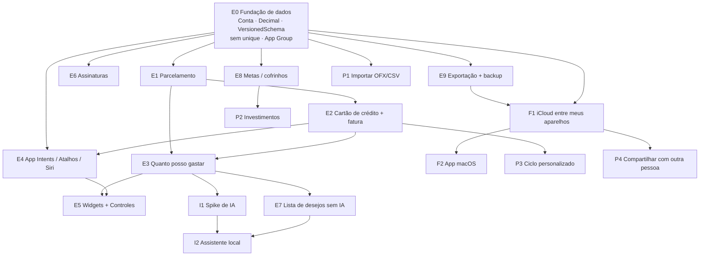

# 🧭 Overview de Produto & Roadmap Competitivo — CashUp

**Documento**: Análise competitiva, decisões de arquitetura de longo prazo e ordem de execução das próximas features  
**Data**: 26/10/2026  
**Base**: `develop` após o PR #38 (i18n)  
**Complementa**: [`gap_analysis_and_roadmap.md`](gap_analysis_and_roadmap.md) (auditoria das lacunas L-01 a L-10) e [`product_vision.md`](product_vision.md)

---

## 1. Direção

O CashUp segue **local-first**: os dados ficam no iPhone e não há servidor. A ordem de evolução é:

1. **Fase 1 — iPhone redondo**: fundação de dados, parcelamento, cartão de crédito, "quanto posso gastar", Atalhos/Siri e widgets, com acabamento de produto publicado.
2. **Fase 2 — Outros aparelhos**: sincronização pelo iCloud entre os aparelhos do próprio usuário e app nativo para macOS.
3. **Fase 3 — IA local**: assistente que explica os números e responde "posso comprar isso?" sem mandar dado para fora do aparelho.
4. **Fase 4 — Profundidade**: investimentos, importação de extrato, ciclo personalizado e compartilhamento com outra pessoa.

**Fora do roadmap por enquanto**: Open Finance (Pluggy) e versão web. Os dois exigem backend, custo recorrente e tratamento de LGPD, e contradizem a proposta "100% privativo, sem servidor".

---

## 2. Estado Atual (o que já existe)

| Área | Situação |
|---|---|
| Transações | Despesa/receita, recorrência virtual (`ExpenseModel.generateOccurrences`), 3 escopos de edição/exclusão |
| Categorias | CRUD completo, paleta, símbolos, favoritos por uso |
| Planejamento | Orçamento por subcategoria, cópia de mês, planejamento recomendado (#37) |
| Coach | `SmartFinancialCoachEngine`: ritmo de gasto, orçamento diário, picos, fim de semana, reforço positivo |
| Segurança e entrada | Biometria, onboarding, notificações locais (#36) |
| Idiomas | i18n de seed, onboarding, datas e moedas (#38) |
| Qualidade | Camada de repositórios com protocolos, ~51 arquivos de teste (unitários + UI) |

### 2.1 Bloqueios estruturais

Estes pontos não são features, mas travam várias delas. Por isso, a **Etapa 0** vem antes de qualquer item novo.

| Bloqueio | Onde | Bloqueia |
|---|---|---|
| Não há entidade **Conta/Carteira** | `ExpenseModel` só referencia categoria | Cartão, fatura, transferência, saldo real, investimentos |
| Dinheiro em `Double` | `ExpenseModel.amount`, modelos de planejamento | Divisão de parcelas e soma de fatura sem erro de centavo |
| `@Attribute(.unique)` em 5 modelos | `CashUp/Models` | Sincronização com CloudKit, que não aceita restrição unique |
| Sem `VersionedSchema`/`SchemaMigrationPlan` | `CashUpApp.makeContainer` | Mudar modelo sem arriscar os dados de quem já usa a versão da App Store |
| Store fora de um App Group | `ModelConfiguration` padrão | Widgets e App Intents lendo os mesmos dados do app |
| Só iPhone (`SUPPORTS_MACCATALYST = NO`, família 1) | `project.pbxproj` | App para Mac (resolvido na Fase 2) |

---

## 3. Panorama Competitivo

| | **Pierre** | **Mobills / Organizze** | **ManagerFinance** (referência open source) | **CashUp hoje** |
|---|---|---|---|---|
| Entrada de dados | Open Finance automático | Manual + Open Finance (pago) | Pluggy + OFX | Manual |
| Cartão e fatura | ✅ | ✅ (ponto forte) | ✅, com ciclo pelo fechamento | ❌ |
| Parcelas | ✅ | ✅ | ✅, detecta e projeta | ❌ |
| IA | Agentes conversacionais na nuvem | Pouca | LLM local (Ollama + Qwen3) com ferramentas | Insights por regra |
| Metas/cofrinhos | Orçamentos sugeridos | ✅ | ✅, com rendimento em CDI | ❌ |
| Lista de desejos | ❌ | ❌ | ✅, lê o preço pelo link | ❌ |
| Plataformas | Mobile | Mobile + web | Web local (exige rodar servidor) | iPhone |
| Privacidade | Dados na nuvem do fornecedor | Nuvem | Local, mas exige backend próprio | **100% no aparelho** |

### 3.1 Leitura crítica

- **Não competir no terreno do Pierre.** O Pierre é da CloudWalk e vence em agregação bancária e IA na nuvem. Copiar isso custa backend, Pluggy pago e a própria tese de privacidade.
- **Diferencial do CashUp**: registro em segundos, captura sem banco (Atalhos + Apple Pay), widgets, ecossistema Apple e IA que não sai do aparelho.
- **Paridade obrigatória no Brasil**: cartão de crédito com fatura e parcelamento. Sem isso, o app não representa o jeito que a persona gasta.
- **O que aproveitar do ManagerFinance** (só as ideias, o código não, porque o stack é Python/Next):
  - **O LLM nunca faz contas**: ele chama ferramentas que devolvem números já calculados por código testado (`docs/assistente-local.md` do repositório).
  - **Previsão de sobra**: entradas previstas − contas fixas que ainda não caíram − meta de poupança (`services/forecast.py`).
  - **Ciclo pelo fechamento do cartão ou pelo dia de início escolhido** (`services/cycles.py`).
  - **Lista de desejos com "cabe neste ciclo?"** (`services/wishlist.py`).

---

## 4. Decisão de IA: Foundation Models × Ollama/MLX

### 4.1 O que cada opção é de verdade

| | **Foundation Models (Apple)** | **Ollama** | **MLX Swift / llama.cpp embarcado** |
|---|---|---|---|
| Roda no iPhone | ✅, nativo do iOS 26 | ❌, é um servidor para Mac/PC | ✅, o modelo vai junto ou é baixado pelo app |
| Roda no Mac | ✅ (macOS 26) | ✅ | ✅ |
| Modelo | ~3B da Apple, contexto de ~4 mil tokens | Qualquer um (Qwen3 4B/8B/14B…) | Qwen3 1.7B–4B no iPhone, maior no Mac |
| Custo para o usuário | Zero, já vem no sistema | Instalar o Ollama e baixar 5–10 GB | Download de 1–3 GB, RAM, bateria e calor |
| Português e raciocínio | Fraco em conhecimento geral, aritmética e raciocínio com várias etapas | Bom (Qwen3 8B+) | Médio (modelos pequenos) |
| Chamada de ferramentas | ✅ (`Tool`) + saída tipada (`@Generable`) | ✅ | Depende do modelo; precisa de mais código |
| Aparelhos suportados | Só com Apple Intelligence (iPhone 15 Pro em diante) | Mac com 16 GB+ | iPhone com 8 GB de RAM para algo útil |

**O Ollama não é uma opção para o iPhone.** No ManagerFinance ele funciona porque o app é uma página web servida por um Mac com 24 GB. No CashUp, o Ollama só serve no app de Mac, ou com o iPhone falando com um Mac da mesma rede, o que é frágil para um produto.

### 4.2 O Foundation Models consegue fazer o que queremos?

Depende de **quem faz a conta**:

| Tarefa | Foundation Models dá conta? |
|---|---|
| "Posso comprar o fone de R$ 450?", com o **código** calculando sobra, impacto no orçamento e mês viável, e o modelo só redigindo a resposta | ✅ Sim. É resumir e explicar dados prontos, o ponto forte dele |
| Escolher qual ferramenta chamar (`quantoPossoGastar`, `faturaAtual`, `gastosPorCategoria`) para uma pergunta curta | ✅ Sim, com poucas ferramentas e respostas compactas |
| Sugerir categoria para a descrição "uber pra facul" | ✅ Sim, com `@Generable` restrito às categorias existentes |
| Fazer contas, projetar meses ou comparar vários cenários sozinho | ❌ Não. Erra números. **Nunca delegar** |
| Chat longo, com histórico e várias trocas de ferramenta | ⚠️ Limitado pelo contexto de ~4 mil tokens. Exige resumir o histórico |
| Conselho financeiro geral ("vale investir em CDB ou Tesouro?") | ⚠️ Raso. Melhor responder com conteúdo curado (`tips.json`) |

### 4.3 Decisão

Arquitetura em três camadas, com o motor de IA trocável por protocolo:

```
          Pergunta do usuário
                  │
   ┌──────────────▼──────────────┐
   │ FinancialAssistantEngine    │  protocolo
   └──────────────┬──────────────┘
      ┌───────────┼──────────────────────┐
      ▼           ▼                      ▼
  RuleBased   FoundationModels      MLX / Ollama (Mac)
  (sempre)    (padrão no iPhone)    (opcional, mais forte)
      │           │                      │
      └───────────┴──── ferramentas ─────┘
                  │
   ┌──────────────▼──────────────┐
   │ Motores determinísticos     │  SafeToSpend, Fatura, Parcelas, Desejos
   │ (código testado, faz conta) │
   └─────────────────────────────┘
```

1. **Os motores determinísticos fazem 100% das contas** e funcionam sem IA. "Cabe no mês?" responde mesmo em aparelho sem Apple Intelligence.
2. **Foundation Models como padrão no iPhone**: custo zero, sem download, privado. Ele só narra e roteia ferramentas.
3. **MLX (ou Ollama local) como opção no Mac**, para quem quer um chat mais capaz. Fica para depois do app de Mac.
4. **Antes da Fase 3**, fazer um *spike* de 1–2 dias: 20 perguntas reais em pt-BR, rodadas no Foundation Models e num Qwen3 4B via MLX, avaliando acerto de ferramenta e naturalidade. A escolha final sai desse teste, não de opinião.

---

## 5. Ordem de Execução e Dependências

### 5.1 Grafo de dependências



### 5.2 Tabela priorizada

Esforço (E) e impacto (I) na escala 1–5.

| Ordem | ID | Item | E | I | Depende de | Fase |
|---|---|---|---|---|---|---|
| 1 | **E0** | Fundação de dados | 3 | habilita tudo | — | 1 |
| 2 | **E1** | Parcelamento (com ajuste de centavos, antecipar e quitar) | 3 | 5 | E0 | 1 |
| 3 | **E2** | Cartão de crédito + fatura | 4 | 5 | E0, E1 | 1 |
| 4 | **E3** | Quanto posso gastar | 2 | 5 | E1, E2 | 1 |
| 5 | **E4** | App Intents, Atalhos, Siri, automação da Carteira | 3 | 4 | E0, E2 | 1 |
| 6 | **E5** | Widgets (tela inicial, bloqueio) + controle na Central | 3 | 4 | E3, E4 | 1 |
| 7 | E6 | Painel de assinaturas | 1 | 3 | E0 | 1 |
| 8 | E7 | Lista de desejos (determinística) | 2 | 4 | E3 | 1 |
| 9 | E8 | Metas e cofrinhos (L-06) | 2 | 4 | E0 | 1 |
| 10 | E9 | Exportação CSV/PDF + backup (L-05) | 2 | 3 | E0 | 1 |
| 11 | **F1** | iCloud entre os aparelhos do usuário (L-08) | 3 | 4 | E0, E9 | 2 |
| 12 | **F2** | App nativo para macOS | 3 | 3 | F1 | 2 |
| 13 | I1 | Spike Foundation Models × MLX | 1 | — | E3 | 3 |
| 14 | **I2** | Assistente local ("posso comprar?", chat com ferramentas) | 3 | 4 | E3, E7, I1 | 3 |
| 15 | P1 | Importar extrato OFX/CSV | 3 | 4 | E0 | 4 |
| 16 | P2 | Investimentos manuais | 4 | 3 | E0, E8 | 4 |
| 17 | P3 | Ciclo personalizado (dia do salário ou fechamento do cartão) | 3 | 3 | E2 | 4 |
| 18 | P4 | Compartilhar com outra pessoa (CKShare) | 5 | 3 | F1 | 4 |

Os itens em negrito formam o caminho crítico. E6–E9 podem entrar entre eles sempre que o caminho crítico estiver em revisão.

### 5.3 Matriz esforço × impacto

```
 IMPACTO
   5 │  E1 Parcelas   E3 Posso gastar          E2 Cartão+Fatura        (Open Finance)
     │
   4 │  E7 Desejos    E8 Metas   E4 Intents   E5 Widgets   F1 iCloud   I2 IA   P1 OFX
     │
   3 │  E6 Assinat.   E9 Export   F2 Mac   P3 Ciclo        P2 Investimentos   P4 Compartilhar
     │
   2 │                                                                (Web)
     └───────────────────────────────────────────────────────────────────────── ESFORÇO
          1–2 (quick wins)              3 (médio)                  4–5 (grande)
```

---

## 6. Detalhamento — Fase 1 (iPhone redondo)

### E0 — Fundação de dados

Uma única migração, testada contra um store gerado pela versão publicada.

- `VersionedSchema` V1 (atual) → V2 (novo) com `SchemaMigrationPlan`.
- Valores monetários **persistidos em centavos inteiros** (`Int64`, ex.: R$ 33,34 → `3334`) e expostos como `Decimal` na camada de domínio. Inteiro é exato, ordena e filtra corretamente em `#Predicate` e sincroniza com o CloudKit sem conversão. Na migração: `centavos = (amount * 100).rounded()`.
- Novo `ContaModel`: `nome`, `tipo` (`.carteira`, `.contaCorrente`, `.cartaoCredito`), `saldoInicial`, e campos de cartão (`limite`, `diaFechamento`, `diaVencimento`). As transações existentes vão para uma conta padrão "Carteira".
- `ExpenseModel.conta` (relacionamento opcional) e novo tipo de lançamento **transferência**, que não conta como receita nem como despesa.
- Remover `@Attribute(.unique)`, deixar todos os atributos com default ou opcionais e os relacionamentos opcionais. Isso já deixa o schema compatível com CloudKit, mesmo com a sincronização ligada só na Fase 2.
- Mover o store para o container do App Group (`ModelConfiguration(groupContainer:)`), copiando o arquivo antigo na primeira abertura.
- **Pronto quando**: o upgrade da versão da App Store preserva 100% dos lançamentos, recorrências e planejamentos (teste automatizado com um store V1 de fixture).

### E1 — Parcelamento

- **Parcelas materializadas, não virtuais.** É uma exceção consciente à RN-04 ("sem poluição de banco"): a recorrência pode ser infinita, mas um parcelamento é finito e limitado (**2 a 72 parcelas**, o que cobre cartão, carnê e financiamento). Por isso, cada parcela vira um registro real:
  - `CompraParceladaModel`: descrição, categoria, conta, `totalCentavos`, `quantidadeParcelas`, `dataCompra`;
  - `ParcelaModel`: `numero`, `valorCentavos`, `dataPrevista`, `status` (`.prevista`, `.paga`, `.antecipada`, `.quitada`), `descontoCentavos`.

  Ter um registro por parcela é o que torna triviais o ajuste de centavos, a antecipação e a quitação.
- **Duas formas de cadastrar**, porque é assim que a compra aparece para o usuário:
  - **Pelo total** (sem juros, ex.: R$ 100 em 3x): o app divide;
  - **Pelo valor da parcela** (com juros, ex.: 10x de R$ 45,90): o total é `parcela × N` e não há divisão.
- **Regra de centavos (pelo total)**: tudo é feito em centavos inteiros. `base = total / N` (divisão inteira) e `resto = total % N`. As `resto` primeiras parcelas recebem +1 centavo. Exemplos: R$ 100,00 em 3x → 33,34 · 33,33 · 33,33; R$ 100,00 em 7x → 14,29 ×4 · 14,28 ×3. As parcelas diferem em no máximo 1 centavo e a soma é sempre exatamente o total.
- **Ajuste manual de uma parcela**: os bancos não seguem todos a mesma regra de distribuição. Se a fatura mostrar outro valor, o usuário edita aquela parcela e o app redistribui a diferença nas parcelas futuras. A soma continua batendo com o total.
- **Antecipar parcelas**: o usuário escolhe quantas parcelas (sempre as últimas, como fazem os bancos) e informa o desconto, se houver; o CDC (art. 52, §2º) garante redução proporcional dos juros. As parcelas escolhidas mudam para a data de hoje (ou, depois da E2, para a fatura aberta) com status `.antecipada`.
- **Quitar o restante**: é a antecipação de todas as parcelas em aberto, num único lançamento com desconto opcional.
- **Na lista**: rótulo "3/10" e um resumo "faltam 7 parcelas · R$ 321,30". Editar e excluir a compra inteira, só esta parcela ou esta e as seguintes reaproveitam os escopos atuais (`RecurringScope`).

### E2 — Cartão de crédito + fatura

- A compra no cartão entra na fatura cujo fechamento vem logo depois da data da compra. A parcela k entra na fatura k − 1 meses depois. Parcelas antecipadas (E1) entram na fatura aberta.
- A fatura tem estado `aberta`, `fechada` ou `paga`. O valor da fatura é a soma do que caiu nela.
- **Pagar a fatura** é uma transferência da conta corrente para o cartão, **não uma despesa**. A despesa já foi contada na compra. É a regra mais importante para não contar gasto duas vezes.
- Limite disponível = limite − fatura aberta − parcelas futuras já lançadas.
- Tela do cartão: fatura atual, próximas faturas (com as parcelas) e histórico.
- Notificação local antes do fechamento e do vencimento (reaproveita o `LocalNotificationService`).
- **Competência na Home, caixa na fatura**: a Home (RN-14) conta a compra à vista no mês da compra e cada parcela no mês da sua `dataPrevista`, nunca o total parcelado de uma vez. A tela do cartão mostra o caixa, ou seja, o que sai da conta em cada vencimento. O pagamento da fatura nunca entra no "Total Gasto".

### E3 — Quanto posso gastar

- Fórmula (competência, coerente com a RN-14): **receitas do mês − despesas do mês − meta de poupança**, em que:
  - as despesas do mês incluem as já lançadas (inclusive compras no cartão e parcelas com `dataPrevista` no mês) **e** as recorrentes que ainda vão ocorrer no mês;
  - **faturas não são subtraídas**: as compras que as compõem já estão nas despesas, e subtrair a fatura contaria o gasto duas vezes;
  - as receitas recorrentes previstas só entram se o usuário marcar a receita como fixa (ex.: bolsa, salário). Renda variável (persona Beatriz, freelancer) só conta quando realizada. Assim o número nunca promete dinheiro que não chegou.
- **Nome diferente do saldo do planejamento**: a RN-14 já define o "Saldo Restante" (só categorias planejadas). Este número se chama **"Disponível no mês"**, para os dois não se confundirem na Home.
- Exibe "R$ X até o fim do mês" e "R$ Y por dia". Evolui o orçamento diário que o `SmartFinancialCoachEngine` já calcula.
- Um único `SafeToSpendService`, com protocolo e testes. É a mesma fonte para a Home, o widget, a lista de desejos e a IA.

### E4 — App Intents, Atalhos e Siri

- `RegistrarGastoIntent` (valor, descrição, categoria opcional, conta/cartão opcional) e `QuantoPossoGastarIntent`.
- `AppShortcutsProvider` com frases em pt-BR ("Registrar gasto no CashUp").
- **Captura automática via Apple Pay**: um tutorial no app ensina a criar a automação "Transação na Carteira" do app Atalhos chamando o `RegistrarGastoIntent`, com comerciante e valor preenchidos. É o substituto do Open Finance sem servidor.
- Suporte ao Botão de Ação e ao Spotlight.
- **RN-17 (biometria)**: com o bloqueio ligado, intents que **leem** dados (`QuantoPossoGastarIntent`) exigem o aparelho desbloqueado (`authenticationPolicy = .requiresAuthentication`). Registrar gasto continua liberado, porque só grava e não revela nada.
- **RN-07 (favoritos)**: lançamentos feitos por intent também incrementam o `usageCount`.
- **Limitação honesta**: a automação da Carteira só pega pagamentos por aproximação com Apple Pay. Pix e débito por app de banco (o principal meio da persona) continuam manuais. Por isso o widget de lançamento rápido (E5) é tão importante quanto a automação.

### E5 — Widgets e controles

- Widget pequeno: "quanto posso gastar hoje". Médio: progresso do orçamento + fatura atual. Tela de bloqueio: valor disponível.
- Botões interativos (iOS 17+) chamando os App Intents do E4 para lançar um gasto com 1 toque nos favoritos.
- Controle na Central de Controle ("Novo gasto").
- Atualização dos widgets via `WidgetCenter.reloadAllTimelines()` após cada gravação.
- **RN-17 (biometria)**: com o bloqueio ligado, os valores aparecem ocultos (`.privacySensitive()`) com o aparelho bloqueado, e há um ajuste "Mostrar valores nos widgets" em Configurações. Sem isso, o widget furaria o Face ID.

### E6–E9 — Complementos locais

- **E6 Assinaturas**: filtra as recorrências marcadas como assinatura, mostra o total mensal e anual e avisa antes da renovação.
- **E7 Lista de desejos**: nome, preço, link (título e imagem via `LPMetadataProvider`), prioridade e status (`desejado`, `comprado`, `desistido`). Responde "Cabe neste mês?" e "Em que mês cabe?" usando o E3, sem IA.
- **E8 Metas**: valor-alvo, prazo, aportes (transferência para uma conta do tipo cofrinho) e aporte mensal sugerido.
- **E9 Exportação e backup**: CSV por período, PDF mensal e um backup completo em arquivo (exportar e restaurar). É a rede de segurança antes de ligar o iCloud.

### Pronto da Fase 1 (critério de "redondo")

- [ ] Upgrade a partir da versão da App Store sem perda de dados
- [ ] VoiceOver, Dynamic Type e estados vazios em todas as telas novas
- [ ] Textos novos no `Localizable.xcstrings`
- [ ] Testes unitários para os motores (parcelas, fatura, safe-to-spend) e testes de UI para os fluxos de cartão e parcelamento
- [ ] Nenhuma tela nova sem retorno visual em erro de persistência (`ErrorAlertModifier`)

---

## 7. Fase 2 — Outros aparelhos

- **F1 iCloud**: ligar `cloudKitDatabase: .private(...)` no `ModelConfiguration`, com entitlements de iCloud + CloudKit e Background Modes (notificações remotas). Depende do schema da E0 já compatível. Inclui um toggle em Configurações e o tratamento do primeiro sync. **Atenção à RN-06**: sem `.unique`, dois aparelhos que rodaram o seed criam as mesmas categorias com os mesmos `SeedIDs`, e o CloudKit não impede a duplicata. É preciso uma rotina de deduplicação após o sync: agrupar por `id`, manter um registro e reapontar as transações e subcategorias dos demais.
- **F2 macOS**: destino macOS nativo no mesmo target SwiftUI (não Catalyst). Inclui layout com `NavigationSplitView`, atalhos de teclado e menu bar extra opcional com "quanto posso gastar". Os mesmos repositórios e serviços são reaproveitados sem mudança.
- **Compartilhar com outra pessoa** (casal, república) fica na Fase 4 (P4). Até onde se sabe, o SwiftData não suporta banco compartilhado com `CKShare` diretamente, o que exige Core Data (`NSPersistentCloudKitContainer`) ou `CKSyncEngine` para essa parte. É um projeto à parte.

## 8. Fase 3 — IA local

- **I1 Spike** (seção 4.3): decide entre Foundation Models e MLX com dados reais.
- **I2 Assistente**:
  - Ferramentas somente leitura sobre os motores: `quantoPossoGastar`, `faturaAtual`, `gastosPorCategoria(mes)`, `parcelasFuturas`, `desejos`, `buscarTransacoes(texto)`.
  - Card "Posso comprar?" na lista de desejos: o motor decide e a IA explica.
  - Sugestão de categoria ao digitar a descrição, sempre com confirmação do usuário.
  - Sem IA disponível (aparelho sem suporte ou recurso desligado), as respostas determinísticas continuam aparecendo.
  - Nenhuma ação que altere dados sem confirmação explícita.

## 9. Fase 4 — Profundidade

- **P1 Importar OFX/CSV**: com deduplicação por data + valor + descrição normalizada e regras de categorização aprendidas com as correções do usuário.
- **P2 Investimentos manuais**: aplicações com aporte, saldo e rendimento estimado pelo CDI (série pública do Banco Central), além de patrimônio total. São dados públicos de mercado; nenhum dado do usuário sai do aparelho.
- **P3 Ciclo personalizado**: mês financeiro começando no dia do salário ou no fechamento do cartão principal. Afeta todas as consultas por período, por isso vem depois do cartão estabilizado.
- **P4 Compartilhamento**: ver Fase 2.

---

## 10. Impacto nas Regras de Negócio

Ao implementar cada item, o [`business_rules.md`](business_rules.md) precisa ser atualizado no mesmo PR:

| Regra | Mudança | Item |
|---|---|---|
| RN-01 | Armazenamento passa de `Double` para centavos inteiros (`Int64`); a validação `> 0` continua | E0 |
| RN-02 | O tipo do lançamento passa de binário para **despesa, receita ou transferência**. Transferência não entra em nenhum total | E0 |
| RN-03 | Transferências (pagamento de fatura, aporte em meta, conta → conta) **não exigem categoria**. Despesa e receita continuam exigindo | E0 |
| RN-04 | Nova exceção: parcelamentos são materializados (2 a 72 parcelas). A recorrência continua virtual | E1 |
| RN-05 | Escopos de exclusão valem também para parcelas (esta, esta e as seguintes, compra inteira) | E1 |
| RN-14 | Parcelas contam no mês da `dataPrevista`; pagamento de fatura não entra no Total Gasto; nova métrica "Disponível no mês", separada do "Saldo Restante" | E1, E2, E3 |
| RN-06 | Deduplicação do seed após sync, já que não há mais `.unique` | F1 |
| RN-17 | Widgets e intents de leitura respeitam o bloqueio biométrico | E4, E5 |
| RN-09, RN-16 | O ciclo personalizado (P3) mudaria a normalização `startOfMonth()` e a navegação ±1 mês. Por isso está na Fase 4 e exige um plano próprio | P3 |
| Novas | Regras de centavos das parcelas, regra de fatura (fechamento e vencimento), limite disponível, antecipação e quitação | E1, E2 |

---

## 11. Referências

- [Pierre na App Store](https://apps.apple.com/app/id6749781755)
- [CloudWalk: Pierre multiagente](https://www.letsmoney.com.br/noticias/cloudwalk-pierre-ia-multiagente-financas-pessoais/)
- [Canaltech: Organizze ou Mobills](https://canaltech.com.br/apps/organizze-ou-mobills-qual-aplicativo-melhor-para-controlar-gastos/)
- [Mobills: apps de controle financeiro 2026](https://www.mobills.com.br/blog/apps-de-controle-financeiro/)
- [ManagerFinance (repositório de referência)](https://github.com/daniellealpimenta/ManagerFinance)
