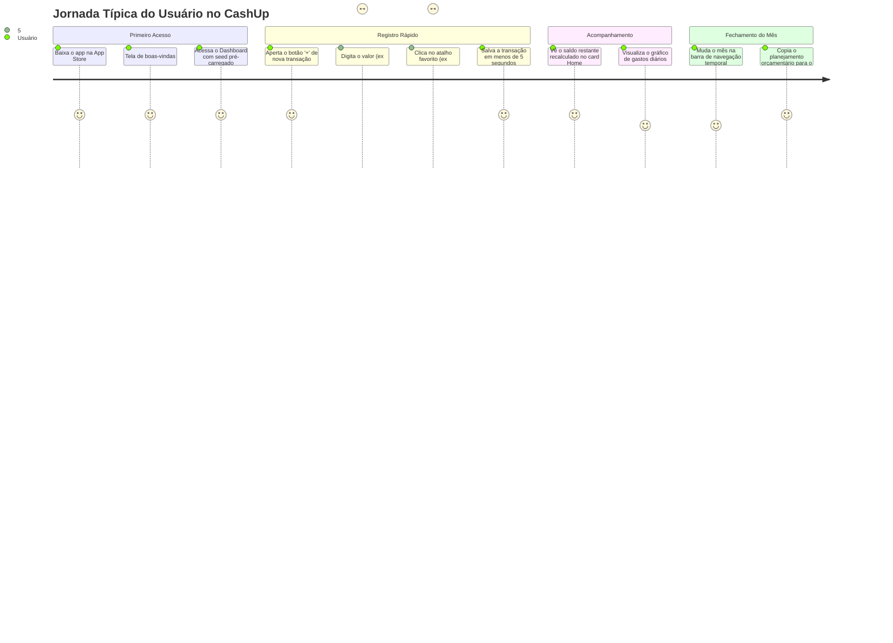

# 🎯 Visão de Produto — CashUp

**Produto**: CashUp — Organizador Financeiro Pessoal  
**Plataforma**: iOS Nativo (SwiftUI + SwiftData); macOS planejado para a Fase 2  
**Idiomas**: Português (Brasil), Inglês e Espanhol  
**Atualizado em**: 26/10/2026 (ordem de evolução em [`product_overview_roadmap.md`](product_overview_roadmap.md))  
**Status**: Publicado na App Store (Apple Developer Academy Project)  
**Público-Alvo**: Jovens universitários, estagiários e jovens profissionais em início de carreira  

---

## 1. Declaração de Visão e Missão

> **Visão**: Capacitar jovens a conquistarem autonomia e tranquilidade financeira através de uma ferramenta simples, visual, privativa e sem fricção.
>
> **Missão**: Transformar a relação do jovem com o dinheiro, substituindo o estresse e a burocracia de planilhas complexas por um acompanhamento diário leve e direto ao ponto no iPhone, e depois em todos os aparelhos Apple do usuário, sem que os dados passem por servidores de terceiros.

---

## 2. O Problema e a Oportunidade

### 2.1 O Cenário Atual
Ao ingressar na faculdade ou iniciar o primeiro estágio, jovens vivenciam o primeiro contato real com a gestão do próprio dinheiro: bolsas, mesadas, salários de estágio, custos com moradia dividida, alimentação universitária, transporte e saídas de fim de semana.

Nesse estágio, a maioria se depara com duas opções frustrantes:
1. **Planilhas complexas (Excel/Google Sheets)**: Exigem disciplina excessiva, digitação manual demorada e são péssimas para preenchimento rápido na rua ou entre aulas.
2. **Aplicativos de bancos tradicionais ou agregadores burocráticos**: Exigem conexão bancária com Open Finance (gerando desconfiança sobre privacidade de dados), cobram assinaturas mensais caras e focam em investimentos avançados, ignorando a necessidade primária de controle do dia a dia.

### 2.2 A Oportunidade do CashUp
O **CashUp** preenche essa lacuna como uma ferramenta **offline-first**, **100% privativa**, com **fricção mínima de registro** (menos de 5 segundos para registrar um gasto) e **feedback visual instantâneo** sobre o impacto daquele gasto no mês.

### 2.3 Posicionamento frente ao mercado
Concorrentes como Pierre, Mobills e Organizze apostam em Open Finance e processamento na nuvem. O CashUp **não compete nesse terreno**. Ele compete em:
- **Velocidade de registro**: atalho, widget, Siri e automação do Apple Pay, em vez de conexão bancária;
- **Realidade brasileira**: cartão de crédito com fatura e compras parceladas, com centavos exatos;
- **Privacidade verificável**: dados no aparelho e, na Fase 2, apenas no iCloud do próprio usuário;
- **IA no aparelho** (Fase 3): um assistente que explica números calculados pelo próprio app, sem enviar dados para fora.

Open Finance e versão web estão fora do escopo enquanto exigirem backend próprio.

---

## 3. Proposta de Valor e Diferenciais Competitivos

```
      ┌────────────────────────────────────────────────────────┐
      │                      CASHUP VALUE                      │
      └────────────────────────────────────────────────────────┘
              │                           │
     ┌────────┴────────┐         ┌────────┴────────┐
     │ Fricção Mínima  │         │   Visibilidade  │
     │  no Registro    │         │    Intuitiva    │
     └─────────────────┘         └─────────────────┘
     • Top 6 categorias favoritas• Gráfico diário de ritmo
     • Teclado numérico direto   • Progresso visual (%)
     • Recorrência virtual       • Saldo restante de orçamento
              │                           │
     ┌────────┴────────┐         ┌────────┴────────┐
     │   Privacidade   │         │    Educação     │
     │    Absoluta     │         │   Financeira    │
     └─────────────────┘         └─────────────────┘
     • Dados locais (SwiftData)  • Regra 50/30/20 integrada
     • Sem login ou servidores   • Coach com insights do mês
     • Bloqueio por Face ID      • Planejamento recomendado
```

### Principais Diferenciais:
- **100% Privativo & Local**: Os dados financeiros nunca saem do dispositivo do usuário. Sem intermediários, sem criação de conta obrigatória em servidores de terceiros.
- **Categorização Inteligente com Favoritos**: O sistema aprende a rotina do usuário através do contador de uso (`usageCount`), disponibilizando atalhos imediatos para as 6 subcategorias mais frequentes (ex.: Café, Restaurante, Transporte Público).
- **Recorrência sem Poluição de Dados**: Despesas fixas (como aluguel, academia, streaming) são projetadas virtualmente no calendário mensal sem inflar o banco de dados com centenas de registros futuros desnecessários.
- **Planejamento Orçamentário Flexível**: O usuário define tetos por categoria e subcategoria, podendo duplicar o orçamento para o mês seguinte com apenas um toque.
- **Identidade Dark Mode Nativa**: Interface desenhada com alto contraste, paleta escura elegante e ícones vibrantes com SF Symbols para máxima legibilidade.
- **Coach Financeiro Local**: O `SmartFinancialCoachEngine` analisa ritmo de gasto, orçamento diário e picos do mês e gera alertas e reforços positivos, tudo calculado no aparelho.
- **Planejamento Recomendado**: Sugestão de orçamento por subcategoria a partir do histórico do usuário, pronta para ajustar e aplicar.

---

## 4. Personas e Perfis de Usuário

### Persona 1: O Universitário Estagiário (Persona Primária)
- **Nome**: Lucas, 21 anos.
- **Contexto**: Cursa Engenharia de Software, faz estágio de 30 horas semanais e recebe uma bolsa/salário de R$ 1.800,00.
- **Dores**:
  - Gasta muito dinheiro com almoços na faculdade, cafés e transporte por aplicativo sem perceber.
  - No dia 20 do mês, a conta já está quase zerada e ele não sabe para onde o dinheiro foi.
  - Tentou usar planilhas três vezes, mas abandonou todas na segunda semana.
- **Necessidades no CashUp**:
  - Abrir o app no ponto de ônibus, registrar o almoço em 4 toques e guardar o celular no bolso.
  - Bater o olho na tela inicial e ver em verde/vermelho quanto ainda pode gastar até o final do mês.
  - Lançar as compras parceladas no cartão (ex.: notebook em 10x) e saber quanto da fatura dos próximos meses já está comprometido.
  - Registrar o gasto sem abrir o app: pelo widget, pela Siri ou automaticamente ao pagar com Apple Pay.

### Persona 2: A Jovem Profissional Autônoma (Persona Secundária)
- **Nome**: Beatriz, 24 anos.
- **Contexto**: Designer freelancer recém-formada, tem receitas variáveis ao longo do mês.
- **Dores**:
  - Incerteza sobre a previsibilidade financeira dos próximos meses.
  - Dificuldade para separar gastos fixos (softwares, aluguel) de gastos supérfluos.
- **Necessidades no CashUp**:
  - Registrar recebimentos esporádicos com data específica.
  - Copiar o planejamento de despesas fixas de um mês para o outro sem retrabalho.
  - Consultar a tela de Dicas para aplicar a distribuição orçamentária 50/30/20.
  - Ver o "Disponível no mês" contando só o dinheiro que já entrou, sem projetar receitas que ainda não chegaram.

---

## 5. Jornada do Usuário (User Journey)



---

## 6. Módulos do Sistema e Escopo Funcional

| Módulo | Objetivo de Negócio | Status Atual |
|---|---|---|
### 6.1 Módulos existentes

| Módulo | Objetivo de Negócio | Status Atual |
|---|---|---|
| **Home (Dashboard)** | Visão panorâmica e consolidada da saúde financeira do mês corrente | ✅ Funcional |
| **Transações & Despesas** | Registro, listagem e edição de receitas/despesas com recorrência e escopos de edição | ✅ Funcional |
| **Planejamento Orçamentário** | Limites por categoria/subcategoria, cópia mensal e planejamento recomendado | ✅ Funcional |
| **Categorias & Subcategorias** | CRUD completo com paleta, símbolos e favoritos por uso | ✅ Funcional |
| **Dicas & Coach** | Insights calculados sobre o mês, distribuição 50/30/20 real e dicas educativas | ✅ Funcional |
| **Boas-Vindas & Onboarding** | Apresentação de valor com simulação interativa | ✅ Funcional |
| **Segurança & Biometria** | Bloqueio por Face ID / Touch ID ao voltar do background | ✅ Funcional |
| **Notificações** | Lembrete diário configurável e alertas de insights | ✅ Funcional |
| **Idiomas** | pt-BR, en e es, com datas e moedas formatadas dinamicamente | ✅ Funcional |

### 6.2 Módulos planejados

Ordem, dependências e detalhes em [`product_overview_roadmap.md`](product_overview_roadmap.md).

| Módulo | Objetivo de Negócio | Fase |
|---|---|---|
| **Contas & Carteiras** | Separar carteira, conta corrente e cartão; transferências fora dos totais | 1 |
| **Parcelamento** | Compras em N vezes com centavos exatos, antecipação e quitação | 1 |
| **Cartão de Crédito** | Fatura com fechamento e vencimento, limite disponível e próximas faturas | 1 |
| **Disponível no Mês** | Quanto ainda dá para gastar no mês e por dia | 1 |
| **Atalhos, Siri & Widgets** | Registro sem abrir o app e consulta rápida, respeitando a biometria | 1 |
| **Assinaturas, Desejos, Metas & Backup** | Complementos locais: painel de assinaturas, lista de desejos, cofrinhos e exportação | 1 |
| **iCloud & macOS** | Mesmos dados em todos os aparelhos do usuário | 2 |
| **Assistente com IA local** | Explicar os números e responder "posso comprar?" sem enviar dados para fora | 3 |
| **Investimentos, Importação OFX & Compartilhamento** | Profundidade para usuários avançados | 4 |

---

## 7. Métricas de Sucesso do Produto (Product Metrics)

### 7.1 North Star Metric
* **Taxa de Dias Ativos com Registro no Mês (Monthly Active Logging Days)**: Média de dias por mês em que o usuário registra ao menos 1 transação.

### 7.2 KPIs de Engajamento e Qualidade
1. **Time-to-Log**: Tempo médio entre a abertura do aplicativo e a confirmação do salvamento da transação (Meta: `< 6 segundos`). Lançamentos por widget, Siri ou automação contam como registro de menor fricção.
2. **Retenção D30**: Porcentagem de usuários que continuam abrindo o app 30 dias após a instalação (Meta: `> 35%`).
3. **Aderência ao Planejamento**: Porcentagem de usuários ativos que mantêm um orçamento mensal configurado (Meta: `> 50%`).
4. **Crash-Free Sessions**: Estabilidade em produção medida via métricas da App Store (Meta: `> 99.8%`).
5. **Integridade em atualizações**: Zero perda de dados em upgrades de versão do schema (validado por teste com store da versão anterior).
